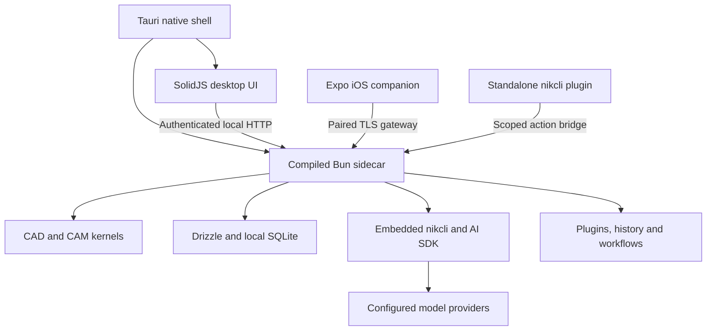

# CADCAMFUN

**A native CAD/CAM workspace for designing parts, planning machining and reviewing the result.**

CADCAMFUN brings parametric modelling, toolpath generation, G-code, engineering libraries and an AI assistant into a desktop application. Project data lives in a local SQLite database. A Tauri shell runs the interface and manages a compiled Bun sidecar that owns the application's services, CAD/CAM operations and integrations.

[Getting started](#getting-started) · [Capabilities](#capabilities) · [Architecture](#architecture) · [Development](#development) · [Releases](#releases-and-distribution) · [Security](#security-privacy-and-data-ownership) · [Licensing](#licensing-and-commercial-use)

## Project status

Version 6 is under active development. The repository contains implemented CAD/CAM kernels, desktop and sidecar applications, AI integration, an iOS companion and release automation. Implementation depth and validation differ by module; a feature's presence in the source is not a claim that every machine, controller or platform combination is qualified.

Use the [work-package status](specs/00-overview.md), [kernel gap analysis](specs/33-kernel-gap-analysis.md) and [release acceptance record](specs/10-release-sync.md) to assess readiness. The six-platform build matrix is configured; packaged installation, signing and updater acceptance must be verified for the version being distributed. The iOS companion has its own build and device-validation requirements.

## Capabilities

### Design and model

- Create and edit 2D drawings and constrained sketches.
- Build parametric parts with a feature history, including extrusion, revolution, holes, patterns and other modelling operations.
- Inspect geometry in an interactive 3D viewport with selection, dimensions and engineering context.
- Work with mesh and exact boundary-representation geometry, including STEP workflows supported by the kernel.
- Produce drawing views and use material, component and engineering libraries.

The [CAD kernel documentation](packages/core/src/cad/README.md) and [measured gap inventory](specs/33-kernel-gap-analysis.md) describe supported operations and their limitations, including complex blends, surface modelling and assembly behaviour.

### Plan and verify machining

- Define stock, tools, machine configurations and machining parameters.
- Generate 2.5D and 3D toolpaths across the implemented roughing, finishing, drilling and profile strategies.
- Work with indexed and simultaneous multi-axis operations where the selected kernel path supports them.
- Organize operations into setups and programs, with tool changes and post-processing.
- Preview tool motion and inspect stock, clearance, collision and machining diagnostics exposed by the selected operation.
- Export G-code through the available post-processors and review production estimates.

Operation coverage varies across milling, turning and other machine families. See the [CAM kernel documentation](packages/core/src/cam/README.md), [multi-operation setup contract](specs/14-multi-op-setup.md) and [kernel acceptance levels](specs/29-native-cam-kernel.md). Review the final NC program against the actual controller, tooling, stock and workholding before machining; a preview or AI response is not machine-specific approval.

### Work with the AI assistant

The assistant uses an embedded [nikcli host](specs/23-ai-runtime-architecture.md) for agent sessions and the AI SDK v7 for direct model calls. It works through the application's CAD/CAM action interfaces, so a drawing edit, toolpath operation or project query uses application services rather than a separate copy of the domain logic.

- Bring provider credentials or use supported account connections.
- Give the assistant project, drawing, toolpath and viewport context.
- Review questions and approval requests in the application.
- Continue supported desktop conversations from the paired iOS companion.
- Connect a standalone nikcli through the public `@cadcamfunv2/cadcamfun-nikcli-plugin` package and a scoped bridge token.

The desktop remains the execution host for companion requests. Remote model calls and connected tools can send selected context to external services; local project storage does not make every AI interaction offline. See [privacy and data flows](PRIVACY.md).

### Review history and extend the workspace

The repository includes Git-style project history, branches, pull requests, GitHub integration and an Actions-style workflow engine. The available interface and registered workflow steps depend on the integration surface; see the [history, workflows and companion contract](specs/13-vcs-actions-mobile.md).

Extensions use the [plugin SDK](packages/plugin-sdk) and the host's declared capabilities. The standalone [nikcli plugin](packages/nikcli-plugin/README.md) exposes the running application's action catalogue over authenticated HTTP; it does not replace the desktop or ship a second CAD/CAM kernel.

## Getting started

### Install a published desktop build

Open [GitHub Releases](https://github.com/nikomatt69/cadcamfun/releases) and choose the operating system and architecture for the version you need. A completed release has an index entry and separate platform entries:

- **macOS:** Apple Silicon or Intel, with `.dmg` installers and updater archives.
- **Windows:** x64 or ARM64, with MSI and NSIS installers.
- **Linux:** x64 or ARM64, with Debian and RPM packages.

The [latest-release link](https://github.com/nikomatt69/cadcamfun/releases/latest) resolves once a public release is marked latest. Installer availability is determined by the assets actually attached to that release.

When its cask has been published to the configured tap, macOS installation is also available through:

```bash
brew install --cask nikomatt69/tap/cadcamfun
```

Updater signatures are required by the release pipeline. Apple Developer signing/notarization and Windows code-signing certificates are separate: without them, macOS builds use ad-hoc signing and Windows installers are unsigned. Release notes describe the signing configuration.

### Run from source

Install these prerequisites first:

- **Bun 1.4.4**, the toolchain version pinned by the root `packageManager` field.
- **Rust and Cargo**, using a toolchain compatible with the checked-in Tauri dependencies.
- **Git** and the native build prerequisites for your operating system.
- On **macOS**, Xcode Command Line Tools for desktop development; full Xcode for iOS work.
- On **Windows**, the MSVC C++ build tools and WebView2 requirements.
- On **Linux**, the WebKitGTK, GTK/app-indicator and native build dependencies used by Tauri.

Follow the official [Tauri prerequisites](https://v2.tauri.app/start/prerequisites/) for platform setup. The [desktop build workflow](.github/workflows/build-platforms.yml) records this repository's bundling dependencies. An AI provider account is needed for remote AI features, not for installing the source dependencies or using local CAD/CAM services.

```bash
git clone https://github.com/nikomatt69/cadcamfun.git
cd cadcamfun
bun --no-env-file install --frozen-lockfile
bun --no-env-file run desktop:dev
```

`desktop:dev` compiles the real sidecar, stages database migrations and starts Tauri with the Vite development server. The shell supplies the sidecar endpoint, launch token and application-data location. The normal desktop startup does not require you to assemble these settings manually.

Legacy `.env*` files are unused by this repository's documented workflow. Use application settings and explicitly supplied process configuration; never copy credentials into source files.

### First project

1. Open or create a project and create its drawing or model.
2. Select the material, stock, tools and machine configuration for the work.
3. Add machining operations and generate the relevant toolpaths or setup programs.
4. Inspect playback, diagnostics and the post-processed G-code.
5. Export the reviewed output or save project history for later review.

AI assistance is optional. Configure the provider in the application's AI settings before asking it to work on the project.

## Architecture

CADCAMFUN separates the native shell, presentation, application services and engineering kernels. The desktop runs a compiled sidecar rather than an Electron/Node application process, allowing the backend to use Bun's SQLite runtime directly.



- **Native shell:** Tauri v2 and Rust own windows, native menus, sidecar lifecycle, operating-system integration and the updater.
- **Desktop interface:** SolidJS, Vite and TypeScript render the application; Three.js supports the CAD/CAM viewport.
- **Application services:** Bun and Effect v4 provide typed service boundaries, configuration, resource lifecycles and HTTP handlers.
- **Persistence:** Drizzle manages SQLite schema and migrations; database access belongs to the database module.
- **Engineering kernels:** CAD and CAM computation live in `packages/core`; pure geometry and toolpath loops avoid an Effect runtime dependency.
- **AI:** nikcli supplies the embedded agent host; AI SDK v7 handles direct calls. Model providers remain configurable external services.
- **Companion:** Expo and React Native provide an iOS client of the paired desktop, not an independent copy of the kernel.

Effect is pinned to **`4.0.0-rc.112`** across the workspace for compatibility with the embedded host. Its APIs differ from Effect v3; use the installed version's documentation and [repository conventions](specs/01-conventions.md).

### Repository map

```text
apps/
  desktop/          SolidJS interface and Tauri/Rust shell
  sidecar/          Bun HTTP server, services and application wiring
  mobile/           Expo iOS companion and native transport modules
packages/
  core/             CAD geometry, CAM kernels and G-code processing
  db/               SQLite schema, migrations and database service
  api/              Effect HttpApi contracts and shared schemas
  httpapi-codegen/  Generated-client tooling for the API contracts
  ai/               Embedded nikcli host, model adapters and application tools
  plugin-sdk/       Extension manifest and host contracts
  nikcli-plugin/    Public @cadcamfunv2/cadcamfun-nikcli-plugin package
  vcs/              Project history, branches, merges and GitHub integration
  workflow/         Workflow definitions, triggers and execution
  buffer/           Validated packed CAM playback data
  identity/         Account service and shared identity client
  web/              Astro documentation site and Studio
scripts/            Build, release, versioning and workflow validation tools
specs/              Contracts, implementation status and ordered remaining work
.github/            CI, platform builds, publishing and shared actions
```

Dependencies point from the application toward its contracts and domain modules. `core` and `api` do not import the database implementation. The desktop uses the API contract; the sidecar wires its implementations. `.reference/`, when present locally, is ignored legacy material used only for domain reference and is never imported.

## Development

### Validate a change

Regenerate the web API reference from the repository root before workspace typechecking:

```bash
bun --no-env-file packages/web/script/generate-api-reference.mjs
bun --no-env-file run typecheck
bun --no-env-file run test
bun --no-env-file run generate:check
bun --no-env-file run lint:workflows
```

`typecheck` runs the workspace checks and root-script checking. `test` covers packages, applications and release scripts. `generate:check` verifies generated API clients; web typechecking also retains the API-reference freshness check. Workflow linting requires `actionlint` on the local PATH; CI installs it explicitly.

For a focused package check or test:

```bash
bun --no-env-file check -p packages/core/tsconfig.json
bun --no-env-file test scripts
bun --no-env-file test packages/db
```

Native Rust validation runs from `apps/desktop/src-tauri` after the sidecar and migration resources have been staged:

```bash
bun --no-env-file run build:sidecar
cd apps/desktop/src-tauri
cargo fmt --all -- --check
cargo clippy --all-targets --all-features -- -D warnings
cargo test --all-features
```

### Database development

Schema ownership belongs to `packages/db`. Change the schema, generate a migration and review the generated SQL rather than editing migration files by hand:

```bash
bun --no-env-file run db:generate
bun --no-env-file run db:migrate
```

The development migration command targets the repository's `data/cadcamfun.db`; a packaged desktop uses its configured application-data directory. See the [database documentation](packages/db/README.md) for schema ownership, synthetic demo data and upgrade behaviour.

### Build and troubleshoot

```bash
# Preview every build step without writing installers.
bun --no-env-file scripts/build.ts --dry-run

# Compile the sidecar and stage migration resources.
bun --no-env-file run build:sidecar

# Build only the desktop web interface.
bun --no-env-file run build:desktop

# Build installers without updater artifacts.
bun --no-env-file scripts/build.ts --no-updater
```

A frontend build does not produce a desktop installer. Full bundling also requires Rust, the target's native dependencies and, when updater artifacts are enabled, a matching Tauri updater signing key. The [build script](scripts/build.ts) supports explicit targets, selected steps and output directories; run it with `--help` for details.

If startup or bundling fails, check the Bun version, native build prerequisites and sidecar build output first. An unavailable AI provider is a separate failure from the local application's geometry, database or shell startup. Report reproducible failures with the commit, platform, command and redacted logs.

## Configuration and operations

The desktop shell manages its sidecar launch configuration. Operators running the sidecar directly must supply its required configuration through the process environment. The authoritative definition is [AppConfigService](apps/sidecar/src/config.ts).

- `CADCAMFUN_TOKEN` authenticates the local application connection; handle it as a secret.
- `CADCAMFUN_DATA_DIR` selects the application's data directory.
- `CADCAMFUN_MIGRATIONS_DIR` optionally selects the staged migration resources.
- `CADCAMFUN_AI_HOST` selects the embedded `nikcli` host by default or the `direct` model path.
- `CADCAMFUN_AI_OFFLINE` controls the application's AI offline mode; it is not a general network-isolation control for every integration.
- `CADCAMFUN_IDENTITY_ISSUER` selects the identity service endpoint.
- `OTEL_EXPORTER_OTLP_ENDPOINT` enables the sidecar's OpenTelemetry exporter when set. Export is disabled without an endpoint.

Optional identity, billing and other hosted integrations have separate configuration and deployment requirements. A desktop build does not deploy these services. See the [identity service documentation](packages/identity/README.md), [web workspace](packages/web) and [privacy policy](PRIVACY.md).

### Data lifecycle and recovery

Project records live in local SQLite storage; exports, session history, logs and credentials can exist separately in the application-data directory. A project export is not a complete installation backup.

The database upgrade path creates a backup before applying pending migrations to an existing database and retains the last five managed upgrade backups. Migrations are forward-only. Consult the release's downgrade notes before installing an older version, and keep a separate backup appropriate to your own recovery needs. Upgrade snapshots do not replace a tested backup-and-restore process for the whole installation.

## Security, privacy and data ownership

The security boundaries differ by connection:

- **Desktop to sidecar:** a shell-managed local connection with a per-launch bearer token.
- **Standalone agent:** a revocable, project-scoped bridge token with read or write permissions; destructive requests remain subject to bridge policy.
- **iOS companion:** a paired TLS gateway with certificate pinning, a scoped device token and a route allow-list.
- **Extensions and workflows:** access follows the host's declared capabilities and the operator's configuration.

Credential storage depends on the integration. Some native operations use the OS keychain; AI provider and OAuth credentials can also persist in permission-restricted JSON files in the isolated application-data directory. These JSON files are not encrypted by their persistence mechanism. Do not assume every credential is stored exclusively in a keychain.

Model requests may include prompts, conversation history, attachments, drawing/toolpath context and viewport images. Connected providers, plugins, synchronization and telemetry introduce their own recipients and retention policies. Review [PRIVACY.md](PRIVACY.md) before using confidential project data with external services.

Use [SECURITY.md](SECURITY.md) for vulnerability reports and [SUPPORT.md](SUPPORT.md) for ordinary issues. Share synthetic reproductions and redacted logs instead of credentials, pairing links, databases or customer drawings.

## Companion and standalone automation

### iOS companion

The phone pairs with a running desktop and reviews projects, history, pull requests, workflows and assistant conversations. The desktop performs the CAD/CAM and agent work. The companion needs a reachable paired gateway; building its JavaScript bundle alone does not validate native networking, signing or a physical-device installation.

Start with [apps/mobile/README.md](apps/mobile/README.md) for pairing, simulator/device builds, pinned transport and the current validation scope.

### Standalone nikcli plugin

The public npm package is **`@cadcamfunv2/cadcamfun-nikcli-plugin`**. Its namespace is the publisher's personal scope; no npm organization is required. Internal `@cadcamfun/*` workspaces and base `@nikcli-ai/*` dependencies keep their existing names.

Configure the plugin with the running application's URL, a scoped bridge token and a project identifier. Follow the [plugin usage and compatibility guide](packages/nikcli-plugin/README.md) for configuration and supported tools. The application remains the authority for the action catalogue and permissions.

## Releases and distribution

Pushes to `main` run the CI pipeline and, after validation succeeds, publish a patch release for all six desktop targets: macOS, Windows and Linux on ARM64 and x64. Release commits and generated/update housekeeping commits do not trigger another publication. Pull requests only run validation.

To start a release manually:

```bash
./scripts/release patch --dry-run
./scripts/release patch
```

`minor`, `major` and an explicit semantic version are also supported. The GitHub CLI must be authenticated, and the CI pipeline workflow must exist on the repository's default branch. The dry run reports the prospective version without dispatching a workflow or publishing assets.

The pipeline:

1. Validates the workspace and workflows, resolves a new version, stamps version holders and refreshes the lockfile.
2. Builds the changelog from commits, commits the release metadata and pushes the version tag.
3. Cross-compiles the six sidecar variants with Bun, then bundles the desktop on the corresponding native runners.
4. Verifies installer checksums, updater signatures and URLs for all six targets. The updater manifest includes macOS archives, Windows NSIS/MSI and Linux Debian/RPM packages, preserving the installed package type.
5. Publishes npm, creates one version release after asset verification, uploads all six targets, signatures, combined checksums and updater manifest, publishes the release and then updates the optional Homebrew cask.

The release is created only after all six desktop targets are built and verified. An upload failure leaves a resumable draft. A failed optional Homebrew publication is reported separately. Prereleases do not advance the stable cask or become the latest stable updater release.

Release credentials belong in GitHub Actions secrets: `NPM_TOKEN`, the Tauri updater signing key/password, optional Apple/Windows signing credentials and `HOMEBREW_TAP_TOKEN`. The tap repository and branch are Actions variables. Credential values are never part of repository configuration. See the [release contract and setup](specs/10-release-sync.md) for the complete names, failure behaviour and acceptance record.

CI definitions:

- [ci-pipeline.yml](.github/workflows/ci-pipeline.yml): orchestrates validation → metadata/tag → all six desktop builds → release creation and publication on `main` pushes. Manual dispatch defaults to validation; `./scripts/release` enables publication.
- [ci.yml](.github/workflows/ci.yml): reusable workspace validation, Rust checks and companion validation; also runs on other branch pushes.
- [build-platforms.yml](.github/workflows/build-platforms.yml): downloadable platform build artifacts without requiring release signing credentials.
- [publish.yml](.github/workflows/publish.yml): reusable version, changelog, commit and tag preparation.
- [publish-release.yml](.github/workflows/publish-release.yml): verifies all assets before npm publication and GitHub release creation, then uploads and publishes.
- [release.yml](.github/workflows/release.yml): sidecar compilation, native installer artifacts and updater manifest validation. Manual dispatch rebuilds artifacts without modifying releases.

## Contributing and project governance

Read [CONTRIBUTING.md](CONTRIBUTING.md) and [AGENTS.md](AGENTS.md) before changing the repository. [Conventions](specs/01-conventions.md) define Effect v4 usage, schema boundaries, database ownership and validation. Cross-package contract changes are documented before their implementations.

The [overview](specs/00-overview.md) records module ownership and implementation status. Remaining work is ordered in the [roadmap](specs/roadmap/README.md); design specifications define the contracts. Repository code, comments, documentation and commit messages are written in English.

Use [issues](https://github.com/nikomatt69/cadcamfun/issues) for reproducible bugs and feature requests. See [governance](GOVERNANCE.md), the [code of conduct](CODE_OF_CONDUCT.md) and [support policy](SUPPORT.md) for review, conduct and contact expectations. Commercial support and response commitments require a separate agreement.

## Licensing and commercial use

CADCAMFUN uses mixed licensing. Original repository material is licensed under [Apache-2.0](LICENSES/Apache-2.0.txt) except for excluded proprietary material and components with separate notices.

The proprietary exclusions are:

- [AI package](packages/ai/LICENSE).
- [CAD kernel](packages/core/src/cad/LICENSE).
- [CAM kernel](packages/core/src/cam/LICENSE).

The complete application includes those proprietary components and is not offered as wholly open-source software. Source visibility does not grant rights to use or redistribute excluded material. Third-party components retain their own licenses and notices.

Read the [repository license and scope](LICENSE), [terms](TERMS.md) and [trademark policy](TRADEMARKS.md). For licensing, commercial use or deployment assistance, contact **Nicola Mattioli** through [the private contact guidance](SUPPORT.md#private-contact).
