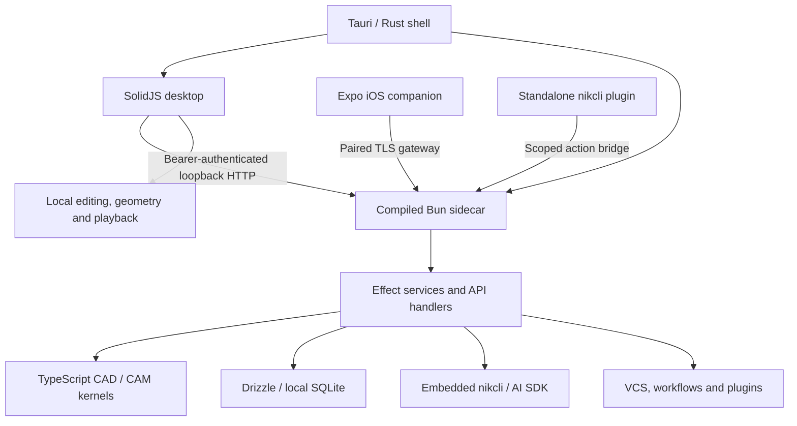

# CADCAMFUN

**Design parts. Plan machining. Inspect the program. Keep the work together.**

CADCAMFUN is a local-first CAD/CAM desktop application with a 2D/3D editor, parametric and exact geometry, toolpath generation, G-code inspection, engineering libraries and an AI assistant. It combines a **Tauri 2 / Rust shell**, a **SolidJS interface** and a **compiled Bun sidecar**, with project records stored in local SQLite.

The repository also contains an Expo iOS companion, project history and workflows, a standalone nikcli plugin, an identity service and an Astro documentation site.

[Get started](#get-started) · [Capabilities](#capabilities) · [Architecture](#architecture) · [Development](#development) · [Configuration](#configuration-and-data) · [Releases](#releases) · [License](#license)

## Current state

CADCAMFUN is under active development. The capabilities below are grounded in the implementation, registered handlers, desktop components and tests in this repository. Links point to those implementations so that support can be checked without treating a design document as shipped behaviour.

Implementation depth varies by operation. Exact solids and derived meshes follow distinct paths; machining results carry explicit verification outcomes. A configured build target or passing unit test establishes a narrower result than installation, device or machine qualification.

The level of each capability is recorded only in the generated [parity scorecard](specs/assets/parity-scorecard.md) (spec 55 §5), from its tests and the corpus; this README does not restate levels.

## Get started

### Desktop builds

Choose an available installer from [GitHub Releases](https://github.com/nikomatt69/cadcamfun/releases). The release configuration targets **macOS, Windows and Linux on ARM64 and x64**:

- **macOS:** DMG installers and updater archives.
- **Windows:** MSI and NSIS installers.
- **Linux:** Debian and RPM packages.

Check the assets and signing notes attached to the selected release. Updater signing and operating-system code signing are separate; the build supports ad-hoc macOS signing and unsigned Windows installers when platform certificates are absent. See the [signing implementation](scripts/signing-config.ts).

### Run the full application from source

Prerequisites:

- **Bun 1.4.4**, pinned in [package.json](package.json).
- **Rust stable and Cargo**, with Rust **1.90 or later**; the [toolchain file](apps/desktop/src-tauri/rust-toolchain.toml) includes Clippy and rustfmt.
- **Git** and the platform's Tauri build dependencies: Xcode Command Line Tools on macOS, MSVC/WebView2 on Windows, or WebKitGTK/GTK and packaging libraries on Linux. The [platform workflow](.github/workflows/build-platforms.yml) records the runner setup.
- Provider credentials for remote AI features. Local editing and geometry do not require a model provider.

```bash
git clone https://github.com/nikomatt69/cadcamfun.git
cd cadcamfun
bun --no-env-file install --frozen-lockfile
bun --no-env-file run desktop:dev
```

The root `desktop:dev` command compiles the real sidecar, stages database migrations and starts Tauri with Vite. The shell supplies the backend address, launch token and application-data directory. Debug builds use a separate data directory with a **`.dev` suffix**.

For interface work without the native application:

```bash
bun --no-env-file run --filter @cadcamfun/desktop dev
```

Outside Tauri, the UI uses an **in-memory fake API** when `VITE_SIDECAR_URL` is absent. To connect it to a real sidecar, supply both `VITE_SIDECAR_URL` and `VITE_SIDECAR_TOKEN` through the process environment before starting Vite. A browser demo does not establish backend persistence or native integration. See [application boot](apps/desktop/src/app/App.tsx) and [endpoint resolution](apps/desktop/src/app/sidecar.ts).

### A first workflow

1. Create a project and open its CAD workspace.
2. Sketch or import a supported drawing/model, then edit geometry and parameters.
3. Select stock, material, tooling and a machine configuration.
4. Define machining operations, choose the setup orientation and generate the program.
5. Inspect motion, diagnostics, verification claims and the posted NC output.
6. Save the project, export the reviewed result or record a history snapshot.

Configure AI in application settings when you want assistance with those tasks.

## Capabilities

### CAD, drawings and exchange

- **2D editing:** lines, arcs, circles, polylines, splines, dimensions, snapping and constrained sketches.
- **Parametric modelling:** editable feature histories, expressions, extrusion, revolution, holes, patterns and further solid operations.
- **Exact geometry:** a TypeScript boundary-representation kernel, history replay, topology and validation, with a dedicated exact-model interface.
- **Mesh modelling:** tessellated previews and derived-mesh operations, including surfacing tools. A mesh operation does not automatically establish an exact solid.
- **Assemblies and drawings:** joints, interference and clearance analysis, BOM and smart fasteners; principal, section and detail views on A4/A3/A2 sheets, with SVG and rasterized PDF export.
- **Libraries:** materials, tools, machines and components used by the editor and manufacturing workflow.

The general CAD import/export dialog implements **JSON/`.cad` and STEP import**, plus **JSON/`.cad`, STL, OBJ and STEP export**. The dialog's file filter also lists STL/OBJ inputs, but its import handler does not implement those branches. STEP export reports exact and faceted content; an exported STEP file can contain both representations. DXF/SVG drawing readers and IGES exchange also exist in the core, with integration that differs from this dialog.

Start with the [CAD exports](packages/core/src/cad/index.ts), [exact kernel](packages/core/src/cad/brep/index.ts), [history exactness tests](packages/core/src/cad/history-exactness.test.ts), [import/export handler](apps/desktop/src/features/cad/components/ImportExportDialog.tsx), [STEP conversion](packages/core/src/cad/scene-step.ts) and [drawing panel](apps/desktop/src/features/cad/components/DrawingPanel.tsx).

### CAM, posts and simulation

- **Milling:** facing, adaptive roughing, pockets, profiles, boring, drilling cycles, thread milling, engraving, chamfering and surface roughing/finishing.
- **Setups and programs:** ordered multi-tool operations, tool changes, orientation recommendations and combined-program output.
- **Multi-axis:** indexed machining and simultaneous rotary planning on supported paths.
- **Turning:** external turning and internal boring previews, plus mill-turn playback and rotary limit inspection.
- **FDM printing:** slicing paths for walls, skin, infill, supports and adhesion, with printer settings and Marlin/Klipper/RepRap flavours.
- **Inspection:** machine-aware playback, stock simulation, NC replay, deviation and collision checks where supported by the operation and machine model.
- **Estimates:** machining and production-cost calculations from the configured inputs.

The implemented post registry contains **Generic, Fanuc, GRBL, Haas, Siemens and Heidenhain**. LinuxCNC is a reserved identifier, not an implemented post.

Kernel results distinguish **`blocked`**, **`preview`** and **`verified-program`**. Claims can pass, fail, remain unresolved or be unsupported; the result exposes that distinction. Turning includes ideal-point preview paths, and rotary/multi-axis checks have unresolved coverage such as rotating-part clearance and material-removal verification. Setup reach analysis does not establish cutter fit or workholding clearance. Machine presets carry assumptions and are not qualified digital twins. Read verification claims in the context of the actual setup and controller before using an NC program.

The implementation is in the [CAM kernel](packages/core/src/cam/kernel/index.ts), [result contracts](packages/core/src/cam/kernel/contracts.ts), [execution and claim evaluation](packages/core/src/cam/kernel/execute.ts), [post registry](packages/core/src/cam/post/index.ts), [stock verification](packages/core/src/cam/verify/index.ts), [printing](packages/core/src/cam/print/index.ts) and [desktop generator](apps/desktop/src/features/cam/components/generator/KernelSection.tsx).

### AI in the engineering workspace

The default assistant runs through the embedded **`@nikcli-ai/sdk-next` host**. **AI SDK v7** also supplies direct model calls. General, CAD and CAM roles can use specialist agents and the application's own action services.

- Supply provider credentials or supported account connections.
- Share project, drawing, toolpath, attachment and viewport context.
- Use application actions for inspection, editing, library work and history.
- Answer questions and permission requests in the desktop interface.
- Extend configured sessions with skills, MCP integrations and plugins.
- Continue assistant work through the paired iOS companion.

The [AI package](packages/ai/src/index.ts), [primary roles](packages/ai/src/nikcli/primaries.ts), [specialists](packages/ai/src/nikcli/agents.ts) and [sidecar AI service](apps/sidecar/src/services/ai.ts) contain the execution paths.

The standalone npm package **`@cadcamfunv2/cadcamfun-nikcli-plugin`** reads the running application's action catalogue and invokes it over authenticated HTTP. Use a project-scoped, expiring and revocable bridge token. The bridge enforces read/write scope and refuses destructive actions that require interactive approval. See the [plugin guide](packages/nikcli-plugin/README.md) and [bridge policy](packages/ai/src/actions/bridge.ts).

### History, workflows and extensions

Project history includes Git-compatible blobs, trees and commits, branches, tags, structural merges, restore operations, pull requests and GitHub synchronization.

Project workflows run against committed snapshots. Registered steps include `project/validate`, `project/require-gcode`, `cam/verify`, `cam/gcode` and `cam/sequence`, with service-backed `vcs/commit`, `notify/push` and `ai/prompt`. A skipped or unsupported verification is reported separately from a verified result.

See the [VCS module](packages/vcs/src/index.ts), [workflow engine](packages/workflow/src/index.ts), [snapshot checks](apps/sidecar/src/services/workflow-steps.ts), [service steps](apps/sidecar/src/services/workflow-service-steps-live.ts) and [assistant step registration](apps/sidecar/src/services/ai.ts). Application extensions use the separate [plugin SDK](packages/plugin-sdk/src/index.ts).

### iOS companion

The Expo/React Native companion pairs with a running desktop through a TLS gateway and certificate-pinned native transport. It provides project and resource management, history, pull requests, workflows, assistant conversations and read-only geometry/toolpath previews, including a native Metal renderer.

The desktop remains the host for CAD/CAM generation and agent execution. Pairing credentials use the iOS Keychain; browser development has a separate storage fallback. A reachable paired desktop is required.

See the [mobile setup guide](apps/mobile/README.md), [native modules](apps/mobile/modules) and [iOS workflow](.github/workflows/ios.yml). The workflow includes simulator Release validation and a pinned-TLS pairing/project roundtrip. Physical-device distribution and TestFlight require separate setup.

## Architecture



The Rust shell owns native windows, menus, file integration, credentials for native operations, sidecar supervision and updates. The sidecar listens on **`127.0.0.1` at a dynamically assigned port** and announces readiness after its health endpoint responds. The desktop also imports the core directly for local editing and viewport computation.

**Effect is pinned to `4.0.0-rc.112`** across the workspace; use the installed version's APIs. Persistence uses **Drizzle `1.0.0-beta.22`** and `bun:sqlite`. Three.js renders desktop geometry. The CAD/CAM kernels are TypeScript; “native desktop” refers to the application shell and platform integration.

### Repository map

```text
apps/
  desktop/          SolidJS UI, Three.js viewport and Tauri/Rust shell
  sidecar/          Bun HTTP server, application services and integration wiring
  mobile/           Expo iOS client, pinned transport and native preview modules
packages/
  core/             CAD, exact B-rep, CAM, drawings, simulation and NC processing
  api/              Effect HttpApi contracts, schemas and generated clients
  httpapi-codegen/  Shared API client-generation tooling
  db/               SQLite schema, migrations, upgrades and storage tools
  ai/               Embedded host, model adapters, agents and application actions
  plugin-sdk/       Application extension contracts
  nikcli-plugin/    Standalone @cadcamfunv2/cadcamfun-nikcli-plugin
  vcs/              Git-compatible project history, merge and GitHub transport
  workflow/         Workflow schema, triggers and execution engine
  buffer/           Validated double-precision binary CAM playback format
  util/             Shared cache, semaphore and single-flight utilities
  identity/         Cloudflare Worker identity service and shared client
  web/              Astro documentation site and local Studio
scripts/            Builds, release preparation, checksums and publishing tools
.github/            CI, native builds and distribution workflows
specs/              Design contracts and planning documents
```

The [API contract](packages/api/src/index.ts) and [sidecar layer assembly](apps/sidecar/src/layers.ts) define the server surface. OpenAPI is served at `/api/openapi.json`. Promise and Effect clients are generated from the contract; multipart, binary and streaming exceptions are tracked by the [generator](packages/api/scripts/generate-clients.ts).

Identity is a separate [Cloudflare Worker](packages/identity/src/index.ts), backed by D1/KV. The [web workspace](packages/web/package.json) builds the Astro site; its development command also starts a local Studio API. Neither service is deployed by building the desktop.

## Development

Run commands from the repository root unless a directory change is shown. The examples disable automatic `.env` loading; use application settings or explicitly supplied process configuration.

### Checks and tests

Regenerate the web API reference **before workspace typechecking**:

```bash
bun --no-env-file packages/web/script/generate-api-reference.mjs
bun --no-env-file run typecheck
bun --no-env-file run test
bun --no-env-file run generate:check
bun --no-env-file run lint:workflows
```

The root test script runs `bun test packages apps scripts`. Workflow linting requires `actionlint`. Tests that exercise native tools also need their platform toolchains; Metal shader tests require the Xcode Metal Toolchain.

For focused work:

```bash
bun --no-env-file check -p packages/core/tsconfig.json
bun --no-env-file test packages/core
bun --no-env-file test packages/db
bun --no-env-file test scripts
```

Evidence (spec 55): the corpus runs every manifest entry against its analytic oracle and fails on a wrong result; the bench judges medians against their budgets and the machine load; the scorecard is regenerated from both.

```bash
bun --no-env-file run corpus
bun --no-env-file run bench
bun --no-env-file run scorecard
```

To validate the Rust shell, first stage the sidecar and migration resources:

```bash
bun --no-env-file run build:sidecar
cd apps/desktop/src-tauri
cargo fmt --all -- --check
cargo clippy --locked --all-targets --all-features
cargo test --locked --all-features
```

The [reusable CI workflow](.github/workflows/ci.yml) runs workspace typechecks, workflow linting, release-script tests, sidecar staging, Rust tests and companion checks. It does **not** run the entire root test suite. Rust formatting, Clippy and dependency-audit findings currently report as advisory.

### Build

```bash
# Inspect the complete build plan without installing or writing artifacts.
bun --no-env-file scripts/build.ts --dry-run

# Compile the sidecar and stage database migrations.
bun --no-env-file run build:sidecar

# Build the desktop web interface.
bun --no-env-file run build:desktop

# Build native installers without updater artifacts.
bun --no-env-file scripts/build.ts --no-updater
```

The [build script](scripts/build.ts) supports explicit targets, step selection and output directories; use `--help` for details. A frontend build produces web assets. Native installers additionally need Rust and platform dependencies; updater artifacts require a matching signing key.

### Database changes

```bash
bun --no-env-file run db:generate
bun --no-env-file run db:migrate
```

Change [schema.ts](packages/db/src/schema.ts), generate a migration and review the SQL. The development migration CLI uses `./data/cadcamfun.db` relative to the **database workspace** by default; an explicit process `DATABASE_URL` overrides it. The desktop uses its own application-data directory. See the [migration CLI](packages/db/src/migrate.ts) and [database guide](packages/db/README.md).

## Configuration and data

Normal desktop startup manages the connection settings. For standalone sidecar operation, [AppConfigService](apps/sidecar/src/config.ts) defines the process configuration:

- **`CADCAMFUN_TOKEN`** and **`CADCAMFUN_DATA_DIR`** are required: connection secret and storage directory.
- `CADCAMFUN_MIGRATIONS_DIR` selects migration resources.
- `CADCAMFUN_AI_HOST` defaults to `nikcli`; `direct` selects the direct-model path.
- `CADCAMFUN_AI_OFFLINE` controls AI offline mode; other integrations have their own network behaviour.
- `CADCAMFUN_IDENTITY_ISSUER` selects the identity endpoint.
- `OTEL_EXPORTER_OTLP_ENDPOINT` enables the telemetry exporter; it is disabled without an endpoint.
- `OTEL_TRACES_SAMPLER_ARG` sets the trace sampling ratio (0..1); unset keeps every trace.

Local project records live in `<data directory>/cadcamfun.db`. SQLite uses WAL and foreign keys, checkpoints on shutdown, and backs up an existing database before applying pending migrations. The upgrade implementation retains the **last five managed database backups**. See [database lifecycle](packages/db/src/index.ts) and [upgrade handling](packages/db/src/upgrade.ts).

Exports, logs, credentials and AI session history can live separately. A project export or database upgrade snapshot is only part of an installation backup. Migrations are forward-only.

### Observability

The sidecar is the one telemetry edge. With `OTEL_EXPORTER_OTLP_ENDPOINT` set, Effect spans, metrics and logs are exported over OTLP/HTTP: the request span of every HTTP call (with the route template and the status), the `ai.turn` span of every assistant turn, and the metric catalogue of requests, AI turns and CAD surface operations. A client that sends a W3C `traceparent` header continues its own trace into the sidecar.

Without a collector, the same numbers are readable on the loopback listener at `GET /metrics`, in the Prometheus exposition format. Telemetry carries shapes, never content: attributes whose key names a prompt, a payload or a credential are dropped before export. See [spec 66](specs/completed/66-effect-opentelemetry.md) and [PRIVACY.md](PRIVACY.md).

### Security and privacy

Desktop requests use a per-launch bearer token over loopback HTTP. Standalone bridge tokens are project-scoped and revocable. Companion connections use a paired TLS gateway, pinned certificates, scoped device tokens and an allowed route set.

Credential persistence varies by integration: native operations use the OS keychain, while AI provider/OAuth credentials can also use permission-restricted JSON in the application-data directory. File permissions do not encrypt those JSON files.

Remote AI requests can include prompts, history, attachments, geometry/toolpath context and viewport images. Providers, MCP tools, plugins, synchronization and optional telemetry have their own data flows. Read [PRIVACY.md](PRIVACY.md); report vulnerabilities through [SECURITY.md](SECURITY.md), and ordinary problems through [SUPPORT.md](SUPPORT.md).

## Releases

The [CI pipeline](.github/workflows/ci-pipeline.yml) is configured to prepare a patch release after successful validation on eligible pushes to `main`. Pull requests run validation. Release metadata and generated/update housekeeping commits are excluded from repeat publication.

Maintainers can dispatch publication with an authenticated GitHub CLI:

```bash
./scripts/release patch --dry-run
./scripts/release patch
```

The command also accepts `minor`, `major` or an explicit semantic version. The dry run does not dispatch or publish.

The pipeline prepares version metadata and a tag, compiles six sidecar variants, builds installers on platform runners and verifies checksums, consistency between updater signature files and the manifest, and asset URLs. It publishes **one GitHub release containing all six desktop targets** after their assets pass validation; upload failures leave a resumable draft. npm publication and Homebrew updates depend on their configured credentials. Prereleases do not advance the stable Homebrew cask.

Implementation: [metadata preparation](.github/workflows/publish.yml), [native builds](.github/workflows/release.yml), [publication workflow](.github/workflows/publish-release.yml), [asset verification](scripts/stage-release.ts), [publishing](scripts/release-publish.ts), [updater manifest](scripts/updater-manifest.ts) and [Homebrew generation](scripts/homebrew-cask.ts).

## Contributing

Read [CONTRIBUTING.md](CONTRIBUTING.md) and [AGENTS.md](AGENTS.md) for module ownership, contract changes and validation requirements. Code, comments, documentation and commit messages are written in **English**. The ignored `.reference/` directory, when present, is read-only domain reference and is never imported.

Use [issues](https://github.com/nikomatt69/cadcamfun/issues) for reproducible bugs and feature requests. Include the platform, commit, command and redacted logs; synthetic project examples make failures easier to reproduce. See [governance](GOVERNANCE.md), the [code of conduct](CODE_OF_CONDUCT.md) and [support](SUPPORT.md) for project policies.

## License

CADCAMFUN has **mixed licensing**. The [repository license](LICENSE) grants Apache-2.0 for original material within its scope, with proprietary exclusions for:

- [`packages/ai/`](packages/ai/LICENSE)
- [`packages/core/src/cad/`](packages/core/src/cad/LICENSE)
- [`packages/core/src/cam/`](packages/core/src/cam/LICENSE)

The complete application includes proprietary components and is not offered as wholly open-source software. Third-party material retains its own notices and licenses. Consult the scoped licenses, [Apache-2.0 text](LICENSES/Apache-2.0.txt), [terms](TERMS.md) and [trademark policy](TRADEMARKS.md).

For licensing or commercial inquiries, contact **Nicola Mattioli** through the [private contact guidance](SUPPORT.md#private-contact).
