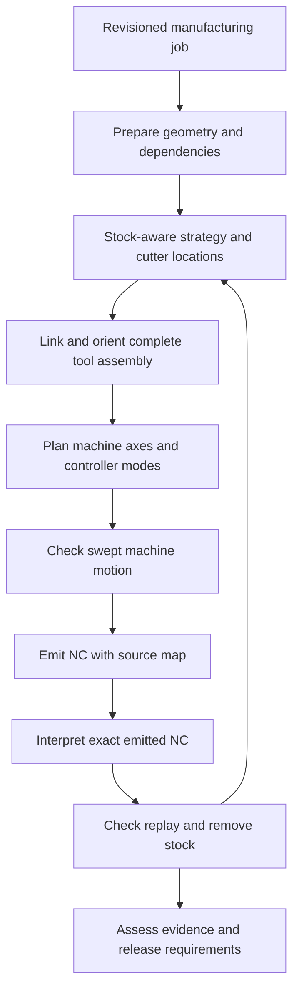

# Native CAM Kernel — Manufacturing Architecture

Status: **design contract; implementation pending**. Requested by the owner on 2026-10-13: build the CAM kernel with the same engineering discipline as the native CAD kernel, targeting the capability depth of hyperMILL. Work is performed in the foreground; this design does not launch background tasks.

This is a WP2 contract increment to [spec 04](04-core-cam.md) and [spec 12](12-professional-cad-cam.md), with a WP1 geometry Seam defined by [spec 03 §7c](03-core-cad.md#7c-native-b-rep-kernel-application-integration-pending). It does not change implementation statuses or the sequence in [the ordered index](roadmap/README.md). RM-02 owns setup grouping; RM-09 owns the permitted pure-core depth slice. Broader machine/controller and native B-rep integration require their scope to be explicitly included in the owning step before implementation. Publishing this contract does not waive those prerequisites.

## 1. Objective and engineering decisions

### Owner-requested application integration (2026-10-14)

The owner explicitly requests enriching the current CADCanvas, CAM components and sidecar API, preserving existing generators. This vertical owns `packages/api/src/cam-kernel.ts`, the existing `toolpathGenerator` group and generated clients; `apps/sidecar/src/http/toolpath-generator.ts`; the desktop CAM API, job builder, generator panel, i18n and matching tests; and the CAD renderer transform/cache fixes and matching tests. It adds authenticated, stateless `POST /api/toolpaths/manufacture` over an explicit CAD snapshot and the current kernel. The response carries the actual NC, IR, operations, tools, stock metrics, claims, release level and job/NC identity. No stored document is changed by generation. Existing toolpath storage remains the save interface; this integration adds no DB migration or new geometric algorithm. Generated results are published only while the source geometry, settings and editor owner remain current, and previous verification evidence is invalidated when a different program is loaded.

The desktop adds a native-kernel section beside the existing operation generator. It uses selected CAD solids, material grades and machine presets; results populate the existing G-code editor and toolpath visualizer. Kernel claims remain attached to their original NC and become stale after edits. The exact CAD renderer must apply placement/gizmo transforms once, preserve face/edge picking and own disposable Three resources independently per canvas.

The CAM store owns the displayed kernel artifact alongside its NC/program, so generic G-code parsing cannot erase the operation/tool structure of a matching kernel program. Its owner scope includes `apps/desktop/src/features/cam/store/camStore.ts` and `screens/CamPage.tsx` for that existing reconciliation path. Evidence remains stale after edits; loading unrelated code never certifies it.

Additive core metadata scope includes `packages/core/src/cam/kernel/{contracts,execute}.ts` and matching kernel tests: artifacts expose the resolved stock bounds in CAD world coordinates, alongside their existing work origin. The viewport adapter converts that box into work coordinates; it must display the stock actually used by the kernel rather than the legacy fallback stock. The selected work offset crosses the existing job/post interface unchanged.

Assistant integration adds `cam_edit.manufacture` beside the read-only `cam.manufacture`: shared input parameters plus optional expected drawing revision; write authority and cancellation checked before storing an eligible artifact. The existing Toolpath row stores the original NC and `data.kernelArtifact`, with drawing/project attribution; no DB migration. The action returns the stored operation ID and a bounded summary. Desktop CAM reconciliation fetches that row, validates artifact/NC identity, and publishes its original multi-tool program/evidence without regeneration. Owners additionally include the existing WP8 CAM action/handler/prompt definitions, WP4 AI handler, WP6 CAM result decoder and matching tests. Blocked/stale/denied runs create no program row.

Artifact identity additionally carries the canonical part-source digest so the same evidence view can compare a saved assistant result with current CAD, without treating different caller job IDs as source changes. The existing job/NC/algorithm digests remain available.

The CAM kernel is a deep **Module** that takes a revisioned manufacturing job and produces machine-specific NC plus evidence about that exact output. Its **Interface** owns units, frames, tolerances, material evolution, motion semantics, failures and release requirements. Its **Implementation** contains geometry queries, strategies, linking, kinematic planning, posts and verification. Callers do not assemble these algorithms themselves.

Decisions:

1. Preserve Bun, TypeScript, Effect v4 rc.112 and the current dependency direction. The numerical kernel is pure and I/O-free. Effect/Schema validate and manage lifecycle at the application edges; no Effect in numerical hot loops.
2. Keep the CAD B-rep as the authoritative part geometry when supplied. Surface contact and trim queries use a geometry Adapter. Meshes, dexels and acceleration structures are derived representations with explicit approximation limits.
3. Model stock evolution once and use it for rest machining, engagement, linking and verification. A previous tool diameter is insufficient to describe the remaining material.
4. Separate cutter-location intent, machine-axis motion and interpreted controller execution. Preserve an explicit initial machine state at every executable entry point.
5. Plan the entire tool assembly and moving machine geometry, including links, rewinds and tool changes. Endpoint clearance alone is insufficient.
6. Verify the emitted NC bytes independently of the post's Implementation. Post changes, text edits and controller configuration changes invalidate that evidence.
7. Keep the existing CAM Interface available during migration. Legacy results carry their actual capabilities; no Adapter promotes sampled preview evidence into machine validation.
8. Capability claims are supported combinations of geometry, strategy, stock representation, machine and controller. A five-axis strategy name alone is not a verified capability.

**Depth** provides **Leverage**: desktop, sidecar and AI get one consistent manufacturing result. **Locality** concentrates tolerance propagation, invalidation and release rules in the kernel rather than repeating them in each caller. The deletion test is concrete: deleting the kernel would force every caller to reconstruct stock dependencies, machine planning and actual-NC verification.

### Commercial reference

OPEN MIND describes hyperMILL VIRTUAL Machining as NC generation and NC simulation using a machine digital twin, with movement/tilt optimization and automatic rewinds. Its five-axis offering supplies a capability reference for collision avoidance and machining strategies. Sources inspected on 2026-10-13:

- [VIRTUAL Machining](https://www.openmind-tech.com/en/cam/hypermill-virtual-machining/).
- [Five-axis milling](https://www.openmind-tech.com/en/cam/5-axis-milling/).

The architecture below is our engineering design inferred from those publicly described capabilities and the repository's existing contracts. It is not a reconstruction of proprietary hyperMILL algorithms. No comparative speed, accuracy or commercial parity has been demonstrated.

## 2. Current implementation and architectural friction

The following paths exist in the repository; the proposed paths in §12 do not yet exist.

- `packages/core/src/cad/brep/index.ts`, `geom.ts`, `nurbs.ts`, `topology.ts`, `validate.ts`: native topology, analytic/rational surfaces, evaluation, projection, Booleans and STEP. Spec 03 §7c records that the app's history and CAM still use the mesh route. Surface projection alone is not a closest-point guarantee on a trimmed face.
- `packages/core/src/cam/operations/`: profile, pocket, drill, face, engraving, adaptive, surface, rest, thread and multiaxis strategies. Reuse these implementations where their capabilities and tolerance contracts are adequate.
- `cam/model/model.ts`, `dexel.ts`, `mesh-queries.ts`: mesh-derived part queries and Z-dexel material intervals. Exact operations on the sampled intervals do not imply exact solid geometry. Grid resolution can grow to fit a cell budget.
- `cam/setup.ts`: validated rigid work frame, stock/fixture boxes, tool-holder dimensions and setup revision. It has no authoritative part revision, complete machine assembly or controller profile.
- `cam/ir.ts`: useful machine-neutral moves, cycles and programs, extended with rotary values. Rotary values currently use degrees. `toolpathStart` infers a position from the first destination; professional execution needs a known initial state instead.
- `cam/five-axis.ts`, `indexing.ts`, `operations/multiaxis.ts`: AC/BC trunnion planning, TCP choices and sampled surface contact. Head kinematics, complete swept assembly checking and machine/controller-qualified execution are absent.
- `cam/verify/path.ts`: replay reduces motion to XYZ segments and omits `Orient` and the rotary values from its verification representation. `cam/verify/verify.ts` checks sampled three-axis tool envelopes against a height field and fixture boxes. `VerifyRequest` supplies one tool. These results cannot validate a full multi-tool, simultaneous-axis setup.
- `cam/testing/gcode-interpreter.ts`: valuable independent post regression helper, also used by verification. It carries some rotary words but is not a complete controller emulator with tool offsets, TCP, machine state or PLC behavior.
- `cam/generator/`: a second, text-oriented generation route with post-processing passes. `dispatch.ts` can skip selected elements with warning comments. That compatibility behavior must not certify completion of a required machining region.
- `cam/program-evidence.ts`: records exact tool IDs and moves independently of labels. It does not identify the complete job, tool geometry, machine/controller state, post configuration or final NC bytes.

Three changes earn the most Depth: unify generation behind one orchestrating Interface; make stock an operation dependency; make machine motion and final-NC verification explicit. Do not rewrite every existing algorithm first.

## 3. Domain records and immutable identity

All serialized records carry `schemaVersion`. Arrays are readonly; input buffers are copied or transferred into exclusive ownership before computation. Runtime query objects and caches never appear in serialized payloads. Unknown versions are rejected; defaults cannot fabricate missing machine data.

Core domain records:

- **PartSnapshot**: content digest, source document ID/revision, placed bodies, geometry kind, selected region references and geometry uncertainty. A body references native B-rep topology or a validated mesh, never an untagged mixture. A selection reference includes body revision and topology identity. Until persistent naming is available, changed topology invalidates the selection and requires reselection; do not select a nearby face automatically.
- **ManufacturingJob**: immutable part snapshot, setups, ordered operations, tools, material parameters, machine/controller/post snapshots and quality requirements. The operation dependency graph must be acyclic and every required region must have an explicit outcome.
- **SetupSnapshot**: rigid placement of part, stock and fixtures; work-offset identity and its actual transform; mounting frame on the machine; selected tool assemblies; initial machine/controller state. Bounds are acceleration envelopes, not fixture solids.
- **OperationSpec**: discriminated strategy/parameter record, selected regions, tool assembly ID, setup ID, stock input dependency, allowance, machining direction, entry/link policy and finish requirements. Avoid an extensible `Record<string, unknown>` as the validated strategy contract.
- **ToolAssemblySnapshot**: cutter shape, flute envelope, non-cutting neck/shank, holder and any angle-head geometry, gauge length, mounting transforms and tool/offset numbers. Catalog diameter alone is insufficient. Separate nominal geometry from measured offsets and their uncertainty.
- **StockState**: representation and payload digest, frame, source stock digest, predecessor stock digest, removal motion digest, numerical error bounds and refinement metadata. Part geometry and stock geometry are distinct.
- **MachineSnapshot**: axis/rigid-body graph, limits, collision geometry/pair policy, calibration/pivots, home and tool-change configuration, controller association and qualified capability records.
- **ArtifactIdentity**: canonical job/part/setup/operation/tool/material/machine/controller/post/algorithm digests, initial state and tolerance policy. Final evidence also binds final NC bytes and interpretation/verification versions.

Canonical serialization specifies sorted record keys, ordered semantic arrays, finite numeric encoding, normalized negative zero and exact buffer encoding. Hashes include schema/algorithm versions and use a deterministic SHA-256 Implementation available without Bun/DOM I/O. Display labels may be excluded from geometric cache keys; they remain included in any key that controls emitted NC bytes. Existing `programGeometryText` remains a legacy Interface and is not treated as the complete artifact identity.

### Frames and units

Every geometry/motion record identifies its frame: `part`, `setup`, `machine`, `tool` or a named machine-body frame. Transforms are rigid, right-handed and explicitly directed (`partToSetup`, `setupToMount`, etc.). Transform functions validate their source/target frame IDs. Reject non-rigid machine placements; scale imported units once before snapshot creation.

New kernel lengths are mm; angles and rotary joints are radians; linear feeds are mm/min; durations are seconds; rotary velocity, acceleration and jerk are rad/s, rad/s² and rad/s³. Linear dynamic limits use mm/s, mm/s² and mm/s³, with explicit feed conversion. Spindle speed remains rpm. Feed-per-revolution and inverse-time feeds are discriminated controller modes, not silently treated as mm/min.

Existing degree-based rotary IR, indexing and strategy settings cross a single versioned compatibility Adapter. Convert at that Seam in both directions and test round trips. Controller degrees/inches and turning radius-versus-diameter conventions are converted only at the controller/post Seam. Do not silently change the meaning of legacy serialized fields.

### Tolerance policy

Carry separate budgets for source geometry uncertainty, contact computation, path approximation, orientation approximation, stock discretization, collision enclosure and controller formatting/interpolation. `finishDeviationMm`, `scallopMm` and `minimumClearanceMm` express different requirements.

For a supported translational finish bound, conservatively account for source + contact + path + NC rounding + controller interpolation error. For changing orientation, include the maximum assembly displacement induced by angular uncertainty, using the relevant distance from the rotation center. Do not add radians directly to millimetres. Stock and collision uncertainty must be accounted for in clearance and residual material comparisons. Show both requested and achieved bounds in the result; an unbounded term means the corresponding claim is unavailable.

An empty toolpath, non-finite value, exhausted budget, unsupported region, unresolved normal or insufficient tolerance cannot be represented as a successful operation. A legitimate no-material operation needs explicit checked evidence.

## 4. Pipeline and public Interface



The feedback edge is sequential: accepted operation output stock becomes the next operation's input. Provisional stock can support planning, but the final emitted sequence must be replayed from the initial stock. If replay changes material evolution beyond the declared budget, downstream strategies are invalidated and recalculated within a bounded repair policy.

Proposed Interface, whose named records are specified in this document:

```ts
type CamResult<T> =
  | { readonly status: "ok"; readonly value: T }
  | { readonly status: "failed"; readonly issues: readonly CamIssue[] }

interface CamKernel {
  prepare(input: ManufacturingJob, adapters: CamAdapters): CamResult<PreparedJob>
  begin(job: PreparedJob): CamResult<CamCursor>
  advance(cursor: CamCursor, quantum: ComputeQuantum): CamStep
  beginNcVerification(input: NcVerificationInput, adapters: CamAdapters): CamResult<CamCursor>
  assessRelease(artifact: CamArtifact, current: ArtifactIdentity, requirement: ReleaseRequirement): ReleaseDecision
}
```

`PreparedJob` contains resolved immutable snapshots, supported capabilities, dependency order and allocated error budgets. `CamAdapters` is a runtime registry, not a serialized request; only installed, versioned Adapters can be selected. `CamCursor` owns an immutable execution checkpoint plus runtime query state, with no filesystem, network, database or global mutation. `CamStep` is `running` with a next cursor/progress record, `completed` with an artifact, `failed` with typed issues, or `cancelled` with a diagnostic checkpoint. Cancelled/failed partial results are ineligible for release.

`ComputeQuantum` sets a deterministic maximum number of work units and a cancellation flag. Advance only at bounded inner-loop checkpoints; bounding the number of stages is insufficient. Resumption must not change the final semantic result. A job-wide node/memory/work budget is distinct from the per-call scheduling quantum. Exhausting the former fails explicitly; reaching the latter yields a cursor.

The initial integration executes these calls in the foreground. It introduces no background job runner. A future scheduling Adapter can manage application responsiveness under separately approved scope without changing numerical semantics. Effect interruption maps to `cancelled`; stale results are discarded before publication.

`CamArtifact` contains per-operation outcomes and stock lineage, cutter-location and machine-motion references, final NC bytes/source map, interpreted trace, verification findings, achieved quality and artifact identity. `NcVerificationInput` accepts the actual NC, explicit initial state, exact setup/geometry/tool/machine/controller snapshots and verification requirements; it does not regenerate a substitute program. Imported NC can have verification evidence without an intent-comparison claim.

`CamIssue` is a tagged diagnostic with stage, operation/setup IDs, optional region/segment/block/body-pair references, expected/achieved quality and a human message. Required tags include invalid input, stale geometry, unsupported capability/controller command, ambiguous initial state, unreachable pose, singularity, axis/dynamic limit, collision, gouge, remaining stock, incomplete region, tolerance not met, budget exhausted, replay mismatch and stale evidence. Effect/HTTP Adapters map these to the existing tagged-error convention.

## 5. Geometry and cutter contact Module

The geometry Seam offers placed-body bounds, bounded point/ray/section queries, trimmed-surface evaluation and normals, closest/contact queries and conservative distance/enclosure queries. Results return either a bounded answer with witness points and source body/face IDs or an explicit unresolved/unsupported result. A normal on a periodic seam or singularity cannot be silently extrapolated.

Two concrete Adapters justify the Seam:

1. **Native B-rep Adapter**: call existing `surfacePoint`, `surfaceDerivs`, `surfaceNormal`, projection and topology functions where adequate. Add trim-loop classification, periodic-domain handling and bounded contact/proximity algorithms inside the owning CAM geometry Module, requesting WP1 additions through spec 03 when required. Validate B-rep topology first. Projecting onto an untrimmed underlying surface must not return a contact outside its face.
2. **Mesh Adapter**: validate finite coordinates, indices, topology and placement; use a triangle BVH and explicit source approximation bounds. Open meshes may support surface preview but cannot claim closed-stock occupancy. Unknown source mesh accuracy limits finish claims even if CAM computations are precise.

Tool shapes are independent of the target surface: flat, ball, bull nose, conical/V, drill and face mill first; barrel/lens cutters require their own contact and swept-envelope fixtures. Derive tip/contact offsets and usable cutting zones from the full cutter profile. Keep non-cutting geometry separate so removing material cannot hide a shank/holder collision.

Float64 is required for numerical geometry. Float32 viewport tessellation is a display Adapter and must not become the authoritative contact model. Reuse native topology and evaluators without claiming that arbitrary B-rep intersections are symbolically exact.

## 6. Stock and material-removal Module

The stock Seam supplies `classifyRegion`, conservative material/clearance queries, remaining-material regions, engagement queries and `subtractSweep`, with input/output identity and error bounds. The Implementation may share memory internally, but published predecessor states remain immutable.

Representations have declared capability limits:

- **Height field**: reuse current three-axis preview/verification on top-accessible stock. Explicitly reject undercut, multi-layer occupancy and rotating-stock claims.
- **Z-dexels**: retain multiple vertical material intervals and support qualified top-accessible roughing/rest queries. Existing `Dexels` supplies interval machinery, but its sampled grid, unpaired ray hits and full physical grid identity must be checked. Equal `nx`/`ny` is insufficient to establish compatible grids.
- **Adaptive volumetric representation**: sparse octree/interval occupancy with conservative inside/outside/uncertain classification, implemented as the target for arbitrary orientations. Three-direction dexels can accelerate it only with a proven conservative reconciliation rule; do not equate merging sampled rays with exact occupancy.

Near tool contact or thin walls, refine uncertain cells up to a declared error and memory/work limit. If the limit prevents the needed bound, return an unresolved claim or `ToleranceNotMet`; increasing cell size is allowed for a labelled preview, not for satisfying a tighter release requirement.

For each accepted motion interval, remove only the cutting envelope swept through material. Retain an outer bound on potentially remaining material for planning and an inner bound on definitely remaining material for reporting; account for sweep uncertainty. Never subtract holder geometry. Store the uncertainty band rather than deleting uncertain stock optimistically.

Operation B consumes the actual output stock of A, including A's entries, links and tool changes where cutting occurs. Rest operations derive their regions from this state and target allowance. Invalidate dependent states when operation order, tool shape, paths, setup or source stock changes. Pure setup transfers require a rigid stock transform and a declared re-fixturing operation; stock cannot reset to a new bounding box.

## 7. Strategy and linking Module

Strategies generate **CutterLocationPath** intent: an explicit initial tool pose, parametric line/arc/helix or bounded spline segments, unit tool-axis direction, optional roll when the assembly requires it, feed/process intent, source region and operation IDs. Contact locations and tool-tip locations are distinct. No controller G/M words or preselected A/B/C angles belong here.

Strategy families and acceptance requirements:

- **2.5D**: profile/pocket/islands/drilling/face/engraving/thread milling. Reuse current algorithms through explicit Adapters; prove cutter compensation, island protection, entry feasibility and requested depth/coverage.
- **3D roughing**: stock-aware adaptive clearing, reachable cavities and true rest material. Bound radial engagement and axial load using swept contact with stock, including entries and links; heuristic engagement samples alone provide preview evidence. Feed adjustment respects declared tool/material data and machine dynamics.
- **3D finishing**: parallel, waterline, steep/shallow, constant scallop, pencil and flowline. Use trimmed surface queries and cutter shape; resolve surface transitions and prove requested deviation/scallop on the supported geometry. Flat-surface ballnose spacing is not a general freeform scallop guarantee.
- **Indexed 3+2**: choose a fixed accessible orientation per region and verify the entire transition between orientations. Cutter locations stay in part/setup coordinates until machine planning.
- **Simultaneous five-axis**: normal/lead/tilt, bounded collision-avoidance orientation corridors, swarf and barrel finishing as separate capabilities. Contact feasibility, stock evolution and machine continuity are coupled; do not discard unreachable required samples and claim completion.
- **Turning/mill-turn**: reserve discriminated operation, spindle/workholding and channel intent. Existing external-turning generation remains a limited Adapter. Full turning, live tooling, stock transfer and channel synchronization need dedicated implementation/qualification; printer generation is outside this subtractive kernel.

The linking Implementation owns lead-in/out, ramps, helices, restarts, retracts, inter-operation moves and tool-change approach. A candidate is checked against current material, protected target regions, fixtures and full assembly, then against machine constraints. A global safe-Z is only a candidate heuristic. If no bounded-clearance link exists, fail explicitly with the blocked segment/body pair.

For multi-axis paths, joint branch selection can invalidate a geometrically valid link. The planner returns that failure to linking and tries a bounded alternative; all attempts share a job budget. Final machine/controller verification remains authoritative.

## 8. Machine kinematics and motion Module

Represent a machine as a directed acyclic assembly graph rooted at its base, with rigid bodies connected by fixed, prismatic, revolute or spindle joints. Each moving joint carries axis/pivot, parent/child transforms, sign, range, continuity/wrap policy, velocity/acceleration/jerk and calibration uncertainty. Model separate base-to-tool and base-to-workpiece chains. Collision solids attach to their moving bodies.

Initial concrete Adapters: Cartesian three-axis, AC trunnion and BC trunnion, using the existing indexing maths as a reference implementation after unit/frame adaptation. Head-head and head-table machines require gauge-length-dependent forward/inverse kinematics and separate tests. A serial-axis list without both chains cannot model table and head motion correctly.

Forward kinematics computes the complete placed machine and tool-relative-to-part pose. Inverse kinematics returns feasible candidates, residuals, branch IDs and singularity metrics, rather than just the first solution. The required orientation may have free roll; fixtures or angle heads may constrain it.

Use a path-level candidate graph and deterministic dynamic programming/shortest-path search. Hard constraints are pose residual, joint/dynamic limits, collision clearance and controller modes. The objective reduces motion time, rotary travel, branch changes, singularity proximity and unnecessary retracts, with documented weights/tie breaks. This is not a claim of a globally optimal continuous solution.

Maintain unwrapped revolute coordinates. Do not normalize every block to ±π. Validate intermediate rotary motion; positions equal modulo 2π can require a hazardous full turn. Rewinds require retract, safe joint transition and re-entry, all rechecked against changing machine/stock geometry. Near singularities, first try alternate branches/orientation corridors and reduced feed; if required quality cannot be met, fail.

Time parameterization uses axis limits and controller feed semantics. Estimate cycle time from timed machine motion, including tool changes, spindle/coolant transitions, dwell and controller assumptions. Distinguish this model estimate from measured machine time.

The output **MachineMotion** contains initial axis/controller state, continuous segment interpolation, joint trajectories in radians/mm, intended TCP trace, feed mode, tool/process events and source cutter-location segment IDs. Validate the actual controller interpolation: without TCP, linear joint interpolation generally does not preserve a straight tool-tip path. Subdivide/replan until its swept deviation is bounded; transforming only endpoints is insufficient.

## 9. Continuous collision and quality Module

Broad phase uses conservative swept bounds/BVH; narrow phase evaluates cutter, shank, holder, head/spindle, table, fixtures, part and evolving stock. Collision pair policy distinguishes intentional cutting from protected material, intentional fixture contact from forbidden interference, and physically adjacent machine bodies. Explicitly record allowed-contact exclusions.

Use continuous collision detection where supported; otherwise subdivide motion with a proven upper bound on linear/rotational displacement and conservative geometry enclosures. Include arc/helix interior extrema, rotary-only motion, tool-change travel, initial assembly placement and the transition into the first cut. A clear result requires complete interval coverage at the declared clearance bound. Fixed pose sampling gives sampled evidence, never continuous-clearance evidence.

For each query return `clear`, `collision` or `unresolved`, plus body pair, path interval, witness geometry, clearance/uncertainty and source operation. `unresolved` cannot count as `clear`. Dynamic machine checks cover the full trajectory, not just axis endpoints.

Quality compares final remaining material to target plus intended allowance, with protected-region identities. Report gouge and uncut material separately, region coverage, maximum bounded deviation, achieved scallop where supported and removed/remaining volume intervals. Volume alone cannot demonstrate dimensional accuracy or preserve a thin wall. Deliberate partial machining declares its excluded regions before generation.

## 10. Post, controller replay and evidence Module

Posts consume machine-qualified motion and a controller profile. They emit NC plus a source map from byte/block ranges to machine/cutter-location segments and tool/process events. Optional tilted workplanes, TCP/RTCP, arc planes, compensation, inverse-time feeds, canned cycles, subprograms and tool-change sequences are explicit capabilities. Never emit a mode that the matched replay Adapter cannot interpret for the requested evidence.

The controller profile identifies dialect/version, supported command semantics, axis interpolation, offsets/compensation, precision, numeric limits, initial modal state, tool tables, acceleration assumptions and modeled auxiliary events. Supported semantics are enumerated, not inferred from a controller brand name. Model only declared PLC/tool-changer actions; unknown motion-relevant auxiliary behavior blocks machine-level evidence.

The replay Implementation is independent of the post: parse the final NC text, reconstruct modal state including selected/active tool and offsets, expand supported cycles/subprograms with recursion/work bounds, and emit **ControllerTrace**. This trace retains rotary-only moves, full joint state, TCP/mode changes, feed semantics, tool changes and source NC block IDs. The existing regression interpreter remains a reference Adapter for its supported subset, not a full digital twin.

Compare replayed execution against the planned motion within separately declared rounding/interpolation bounds. Check the replayed trace against the initial stock and complete machine geometry, then measure final quality. A final NC optimization/text pass always precedes interpretation and byte hashing; no rewrite is permitted after verification without rerunning it. Multi-tool replay resolves every active assembly, never verifies all paths with one cutter.

Evidence records:

- Exact NC SHA-256, artifact/job identity, initial stock/state, active tools/offsets, machine/controller/post and verification versions.
- Claims for coverage, geometry quality, stock removal, assembly clearance, machine limits/dynamics, controller semantics and intent agreement; each is `passed`, `failed`, `unsupported` or `unresolved` with its achieved bounds.
- Findings with NC block/operation/body references and deterministic test/algorithm provenance.

Release requirements are conjunctive and capability-specific. `preview` can expose incomplete/sampled results with their limitations. `verified-program` requires all declared claims to pass at the requested quality and identity to match the current job. `qualified-machine-program` additionally requires a commissioning record for the exact relevant machine/controller/post configuration and supported modes. A commissioning record documents independent controller checks and supervised dry runs; software cannot create one by generating a green report.

`assessRelease` returns allowed/blocked and missing/stale/failed claims. Evidence is revalidated against current document/setup/library revisions when persisted or exported. An unrelated NC text edit invalidates byte identity even if it appears geometrically harmless. UI/AI cannot override a failed required claim by changing a warning severity.

## 11. Determinism, performance and application Seams

Use spatial indices, bounded subdivision, compact Float64 buffers and structural sharing before choosing another runtime. Cache by complete semantic identity: geometry queries by body/frame/tolerance; stock by predecessor/removal/bounds; machine planning by calibration/controller/initial state; NC by motion/post/options; evidence by final bytes and all verification inputs.

Measure preparation, generation, linking, axis planning, removal, post and replay separately, with peak memory and work counts. Benchmark proposed reference scales of 100k/1m triangles and 10k/100k motion blocks on a recorded hardware/runtime configuration. These are workload targets, not current performance results. Set numeric latency/memory acceptance limits after the first measurement and before advertising responsiveness. If native/WASM acceleration becomes necessary, implement it as an Adapter behind a demonstrated hot Seam with differential tests and deployment/license review; do not add a kernel dependency speculatively.

WP4 owns an Effect application Adapter that loads immutable authorized snapshots, invokes the kernel, propagates cancellation and rejects stale publication. WP3 owns schema validation and API versioning. WP0 owns any migrations. WP6 consumes progress, artifacts and evidence without implementing geometry or machining rules. WP8 can propose operations and bounded repairs through the same contract; it cannot fabricate successful verification. These are future integration contracts, not edits authorized to those directories by this document.

Maintain existing HTTP/action contracts until a versioned migration exists. Legacy endpoints can retain compatibility output while returning capability metadata through an explicitly specified extension. Do not silently enforce new export behavior in an unrelated UI change.

## 12. Proposed locality and migration

Proposed WP2 layout (all paths below are future files):

```text
packages/core/src/cam/kernel/
  index.ts                 # narrow public Interface
  contracts.ts             # domain records and capability/error unions
  identity.ts              # canonical artifact identity and invalidation
  prepare.ts               # resolve job, capabilities and dependencies
  execution.ts             # bounded, resumable pure pipeline
  geometry/                # native B-rep and mesh query Adapters
  stock/                   # height-field, dexel and volumetric Adapters
  contact/                 # cutter profiles and surface contact
  planning/                # strategy registry, dependencies and links
  motion/                  # machine graphs, IK branches and timed paths
  collision/               # conservative swept checks and findings
  controller/              # emitted-NC interpretation and replay
  evidence/                # claims, quality and release assessment
  compatibility/           # current IR/settings/degree conversion Adapters
```

Keep numerical Implementation near its owning concept; do not create pass-through files for every stage. Reuse existing `operations/`, `post/`, `model/`, `verify/` through concrete Adapters first. `cam/kernel/index.ts` becomes the new kernel Interface only after its first gate passes; public `cam/index.ts` retains legacy exports throughout migration.

Implementation dependency gates below refine contracts; they are not a replacement implementation schedule:

1. **Foundation**: immutable snapshots, radian/frame conversion, explicit initial state, capability registry, complete identity and pure execution Interface. Depends on setup grouping contracts. First end-to-end fixture: three-axis pocket with island, complete tool assembly and a fixture; final emitted NC replay and operation stock lineage.
2. **Reliable three-axis manufacturing**: bounded cutter contact, stock carried between rough/rest/finish, conservative cutter/holder collision, multi-tool replay and stale-evidence checks. Native B-rep consumption additionally waits for WP1's integration and explicitly authorized geometry Adapter scope. Keep the mesh Adapter usable within its approximation contract.
3. **Machine-qualified indexing**: Cartesian/AC/BC graph Adapters, transition collision checks, offsets, source maps and qualified controller subsets. No simultaneous-axis claim before these pass.
4. **Simultaneous five-axis**: path-level IK/rewinds, dynamic limits, arbitrary-orientation stock and continuous full-machine checking, TCP and non-TCP replay. Add head/head-table Adapters through separate reference fixtures.
5. **Advanced finishing and manufacturing families**: constant scallop/flowline/swarf/barrel, turning/mill-turn and probing with their specific tool/contact/controller/workholding gates. Add specialized blade/impeller/tube strategies only after general five-axis quality is demonstrated. Machine connectivity remains an external application Adapter.

No big-bang replacement. Stop routing a particular operation through `generator/` text production only after its new kernel Adapter passes legacy goldens and independent motion/quality fixtures. Unknown selected elements and skipped required regions must block professional completion, while compatibility behavior remains explicit.

## 13. Acceptance fixtures and evidence required

Test through the public Interface and real geometry/machine/controller Adapters. Use analytical reference geometry and an independently implemented numerical oracle where applicable; merely comparing a generator to its own helper cannot establish machining quality.

Required fixture families:

1. **Frames and identity**: translated/rotated setups, inch import, degree/radian migration and turning diameter conventions; pose round trips within allocated uncertainty. Change part, fixture, holder, work offset, gauge length, material limits, operation order, controller or NC bytes: every affected cache/evidence claim becomes stale.
2. **Pocket with island**: analytically known removed region, safe entries and protected island/fixture. Drill/rough/rest/finish use different assemblies; downstream stock matches a fresh replay of the emitted complete job.
3. **Residual material and thin walls**: narrow rib and undercut between sampling planes; volumetric queries either resolve it within tolerance or return unresolved. Budget exhaustion/coarsening cannot create a passing clearance/finish claim.
4. **Surface contact**: plane, sphere, cylinder, torus and trimmed NURBS patch with periodic seam, hole boundary and singular normal. Ball/flat/bull-nose contact and scallop/deviation use an independent distance oracle and allocated error bound.
5. **Swept collision adversaries**: endpoints clear but holder collides halfway; rotary-only table/fixture collision; rapid through remaining stock; first positioning move; tool-change path; arc/helix interior extremum. Each returns a collision interval/body pair, not just a displayed animation.
6. **IK and interpolation**: AC/BC FK-to-IK residual, multiple branches, angle wrap, singularity neighborhood, axis travel/dynamic limits and retract/rewind/re-entry. Non-TCP controller joint interpolation is compared against intended TCP along the interval, not only at endpoints.
7. **Controller/post**: existing three-axis goldens plus multi-tool cycles, work/tool offsets, TCP transitions and inverse-time cases for each supported dialect. Unknown command, unmodeled auxiliary motion, ambiguous start and missing assembly block the relevant claims. Inject wrong rounding/feed/axis/post output and require independent replay to detect it.
8. **Lifecycle and budgets**: cancel and resume at every stage; different compute quanta yield the same artifacts/findings. A stale publication or failed required operation produces no releasable program. Repeat the same input to get byte-identical deterministic NC and semantic evidence, excluding explicitly external timestamps.
9. **Qualification**: final fixture NC checked independently on the identified controller configuration, followed by recorded supervised machine dry runs. Keep qualification records separate from software unit-test outcomes.

Proposed commands once the corresponding Implementation exists:

```sh
bun --no-env-file test packages/core/src/cam/kernel
bun --no-env-file test packages/core
bun --no-env-file x tsc -p packages/core/tsconfig.json
git diff --check -- packages/core/src/cam specs/04-core-cam.md specs/12-professional-cad-cam.md specs/29-native-cam-kernel.md
```

The first path does not exist yet; it is an implementation gate, not a claimed test result. This design-only change is verified by checking links, current-source references and diff formatting. No runtime behavior or machining qualification is claimed by publishing it.

## 14. Decisions still requiring real-world inputs

The architecture is fixed enough to implement its foundation. Qualification additionally needs a real target machine's kinematic/calibration/axis data, controller version/options and interpolation semantics, tool assemblies and fixtures, representative parts and measured quality/time requirements. Synthetic AC/BC examples establish software behavior only. Missing machine data does not prevent foundation work, but it prevents machine-qualified release.

## Change log

- 2026-10-13: owner-requested native CAM kernel architecture. Recorded current-source gaps, deep kernel Interface, authoritative geometry Seam, stock lineage, radian/frame migration, continuous machine motion, independent final-NC replay, capability/evidence release rules, owner scopes, dependency gates and adversarial acceptance fixtures. Design only; no source code, background task, commit, implementation status or commercial parity claim.
